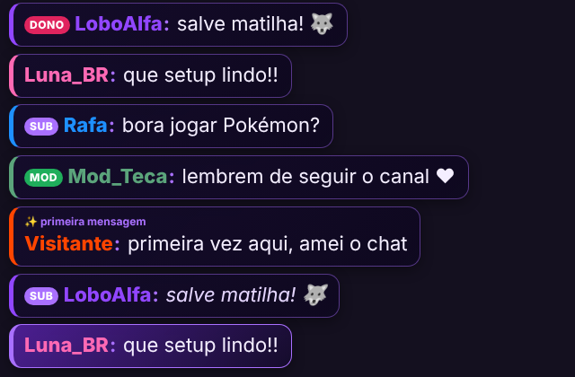
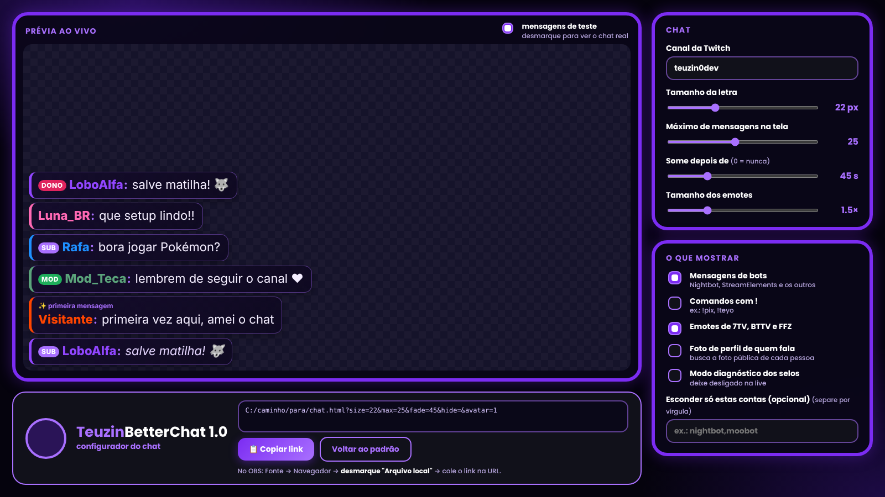

# 🐺 TeuzinBetterChat 1.0

Widget de chat da Twitch **leve, sem login e sem token**, feito para a *Fonte de navegador* do OBS. Um único arquivo HTML, sem instalação e sem dependências.



## Recursos

- Lê o chat direto da Twitch por leitura anônima (IRC via WebSocket). Não precisa de conta, token nem Client-ID.
- **Selos oficiais** (broadcaster, mod, VIP, sub, founder, **Lead Moderator**, etc.) pelas APIs públicas da Twitch, com plano B pela IVR.
- Emotes da Twitch e também **7TV, BTTV e FFZ** (globais e do canal).
- **Foto de perfil** de quem fala (opcional).
- Anúncios, subs, resubs e outros avisos do canal (USERNOTICE).
- Mensagem apagada, timeout e ban removem a mensagem da tela.
- Esconde bots, comandos `!` e qualquer prefixo que você definir (ex.: `?fd`, `$pescar`), destaca primeira mensagem.
- Mensagens somem sozinhas depois de N segundos.
- **Configurador visual** que gera o link pronto para colar no OBS.



## 🎬 Overlay de clips do `!so`

Quando alguém usa `!so nomedocanal`, toca um clip aleatório daquele canal na sua live. Tem configurador, link curto, prévia e ducking de áudio. **Guia completo: [SO-CLIP.md](SO-CLIP.md)**.

## Como usar (online, pelo GitHub Pages) — recomendado

Com o GitHub Pages ligado, o configurador já entrega um **link da internet** pronto para o OBS, sem precisar de arquivo no PC:

1. Abra `https://www.teuzin.com.br/TeuzinBetterChat/` (ou `https://SEU-USUARIO.github.io/TeuzinBetterChat/`) (o `index.html` leva ao configurador).
2. Ajuste as opções e clique em **Copiar link**.
3. No OBS: **Fontes → + → Navegador**, **desmarque** "Arquivo local" e cole o link na URL.

Para ligar o Pages: *Settings → Pages → Deploy from a branch → `main` / `(root)`*.

## Como usar (offline, arquivos locais)

1. Baixe esta pasta (ou clone o repositório) e deixe `chat.html` e `config-chat.html` juntos.
2. Abra `config-chat.html` no navegador, escolha o canal e as opções e clique em **Copiar link**.
3. No OBS: **Fontes → + → Navegador**.
   - **Desmarque** "Arquivo local" e cole o link copiado na URL.
   - Largura e altura à sua escolha (ex.: 480 × 900), e marque "Atualizar navegador quando a cena ficar ativa".
4. Para testar sem estar ao vivo, use `demo=1` no link.

Se preferir apontar para o arquivo, marque "Arquivo local" e escolha `chat.html`; os parâmetros vão depois do `?` na URL.

## Parâmetros da URL

| Parâmetro | Padrão | O que faz |
|---|---|---|
| `channel` | `teuzin0dev` | Canal da Twitch |
| `size` | `20` | Tamanho da letra (px) |
| `max` | `25` | Máximo de mensagens na tela |
| `fade` | `45` | Some depois de N segundos (`0` = nunca) |
| `emote` | `1.5` | Tamanho dos emotes |
| `hide` | lista de bots | Contas escondidas, separadas por vírgula. `hide=` vazio mostra todos os bots |
| `pre` | vazio | Esconde mensagens que **começam** com esses textos, separados por vírgula ou espaço. Ex.: `pre=?fd,$pescar` (não diferencia maiúsculas) |
| `cmds` | `0` | `1` mostra comandos que começam com `!` |
| `ext` | `1` | `0` desliga emotes 7TV/BTTV/FFZ |
| `avatar` | `0` | `1` mostra a foto de perfil |
| `debug` | `0` | `1` mostra o nome técnico de cada selo |
| `demo` | `0` | `1` usa mensagens de teste, sem conectar |

Exemplo:

```
chat.html?channel=seucanal&size=24&max=20&fade=60&avatar=1
```

## Dúvidas comuns

- **Selos ou emotes não aparecem:** atualize o cache da fonte no OBS e use `debug=1` para ver quais selos foram encontrados.
- **Respostas de bots não aparecem:** use `hide=` (vazio) e, para comandos, `cmds=1`.
- **Fotos de perfil:** vêm de serviços públicos (unavatar, com plano B pela IVR). Quem não tiver foto aparece com a inicial do nome.

## Privacidade e termos

- [Política de Privacidade](https://www.teuzin.com.br/TeuzinBetterChat/privacidade.html) · [Termos de Uso](https://www.teuzin.com.br/TeuzinBetterChat/termos.html) (fontes em `privacidade.html` e `termos.html`).
- **Chat só para exibir:** o widget lê o chat público e não grava mensagens. Sem cadastro, sem anúncios, sem estatísticas.
- **Login (2.0, opcional):** os tokens de Twitch, Kick e Google/YouTube ficam só no `localStorage` do seu navegador. O worker (`kick-worker/`) guarda o segredo dos apps da Kick e do Google e apenas repassa os pedidos; o relay (`relay/`) só repassa o chat público.
- **Cuidado com o link:** a opção "colocar o login no link" e a chave da API do YouTube no link tornam o link tão sensível quanto uma senha. Nunca mostre na live.
- **Serviços de terceiros:** fotos de perfil (unavatar/IVR/DecAPI, desligado por padrão), emotes (7TV, BTTV, FFZ) e selos da Twitch recebem o IP de quem roda o chat; o configurador carrega fonte do Google Fonts.
- O TikTok usa uma biblioteca não oficial e é experimental.
- Não é afiliado a Twitch, Kick, Google/YouTube ou TikTok.

## Licença

[MIT](LICENSE). Feito com 💜 pela matilha do Teyo.

## Versão 2.0 beta: multichat e login (branch `feat/multichat-auth`)

- **Multichat:** Twitch + Kick + YouTube na mesma tela, com selo da plataforma. TikTok via relay local (veja `relay/`).
- **Login da Twitch (opcional):** o configurador tem o botão "Entrar com a Twitch". Cada streamer pode usar o **próprio Client ID** (registrado em dev.twitch.tv) ou o do projeto, quando existir. O token fica só no seu navegador e só entra no link se você marcar.
- Parâmetros novos do link: `kick`, `kickid`, `yt`, `ytkey`, `ytint`, `relay`, `plat`, `login`, `token`, e `channel=` vazio para não usar a Twitch.

| Plataforma | Como lê | Observações |
|---|---|---|
| Twitch | IRC (anônimo ou autenticado) | já estável |
| Kick | WebSocket público da sala | não oficial, pode mudar; precisa do número da sala |
| YouTube | YouTube Data API v3 (consulta periódica) | precisa de chave; a cota diária é limitada |
| TikTok | relay local não oficial | experimental, roda no seu PC |

Beta: Kick, YouTube e TikTok foram testados só com conexões simuladas, ainda não numa live real.

### Painel da Kick (enviar mensagens e moderar)
`painel.html` entra com a Kick (OAuth + PKCE), envia mensagens como o dono do canal e mostra o chat com botões de apagar, timeout (10 min) e banir.
Precisa do worker em `kick-worker/` (guarda o segredo do app). Veja `kick-worker/README.md`. Beta, ainda não testado numa conta real da Kick.
